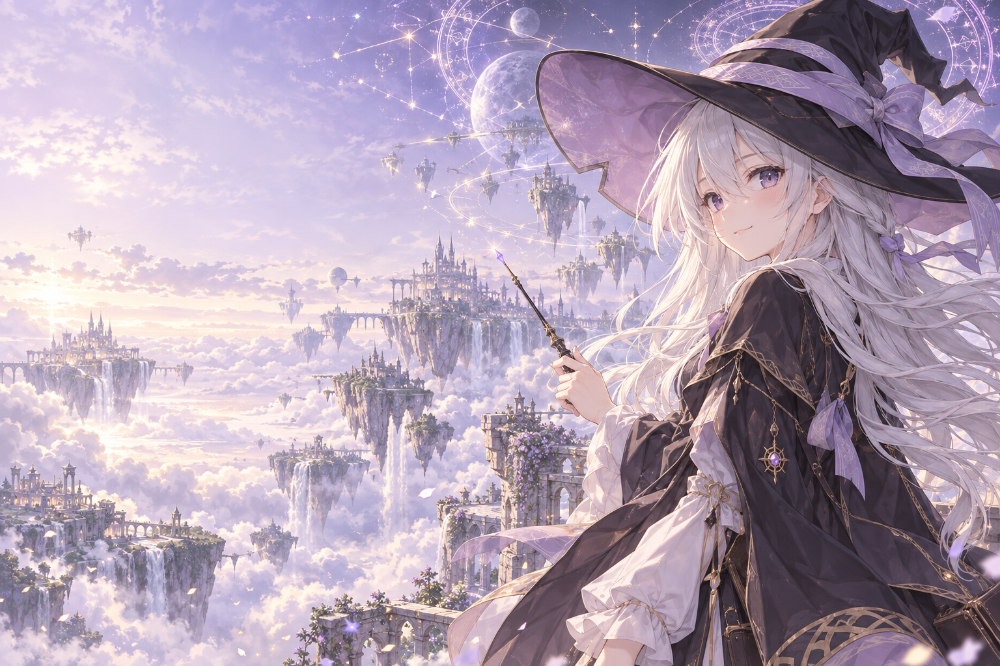

# Omniworld Launcher

基于 [HMCL 3.17.0.361](https://github.com/HMCL-dev/HMCL) 的非官方 Minecraft Java 版启动器定制项目。当前定制版本：**1.2.0**。



## 功能

- mac 风格窗口、顶部导航、伊蕾娜主题首页及统一启动区域。
- 双层魔法阵、星尘、流星、鼠标拖尾与点击涟漪，支持显示脉冲同步和可选帧率限制。
- 自定义头像 EXE 图标、猫咪鼠标和轻柔点击音效；动效、音效和鼠标偏好可在设置中调整。
- 默认保持启动器可见，覆盖旧游戏配置中的隐藏/关闭行为；可在设置中关闭这一覆盖。
- Minecraft 默认窗口为 **1920 × 1680**，已有明确自定义尺寸保持有效。
- 修正微软设备码登录请求参数和错误响应处理；支持配置自己的公共 Microsoft 应用 Client ID。

## 构建与运行

需要 JDK 17 或更新版本，首次构建需要联网下载 Gradle 和依赖。Windows EXE 中已包含 JAR、图标与音效，但没有打包 Java 运行时。

Windows PowerShell：

```powershell
.\tools\Build-Omniworld.ps1
```

也可以手动构建：

```powershell
$env:VERSION_ROOT = '1.2'
$env:BUILD_NUMBER = '0'
.\gradlew.bat :HMCL:makeExecutables
```

输出在 `HMCL/build/libs/`，Windows 双击 EXE 或运行 `java -jar HMCL/build/libs/HMCL-1.2.0.jar`。
Windows 构建会在追加 JAR 前修改 EXE 引导程序的图标资源；其他平台可构建 JAR。预生成的素材已纳入源码，无需原始参考图。

修改头像素材时，可运行 `tools/Prepare-OmniworldAssets.ps1 -SourceImage <图片路径>`。该脚本也会重新生成点击音效。
GitHub 的 Actions 页面提供手动触发的 **Build Omniworld (Windows)** 工作流。原 HMCL 专用工作流保留在 `.github/upstream-workflows/`，不会作为此仓库的 Actions 自动执行。

## 微软登录

此非官方项目不内置 HMCL 官方应用凭据。请自行准备已注册并获准使用 Minecraft 服务的 Microsoft 公共客户端 ID；不要将 Client Secret 或账户令牌写进源码。

可在登录界面填写 Client ID；也可通过 `MICROSOFT_AUTH_ID` 构建环境变量或 `-Dhmcl.microsoft.auth.id=...` JVM 参数配置。合法应用注册和本人浏览器授权仍是完整登录的前提。

## 验证

```powershell
.\gradlew.bat :HMCL:test --tests org.jackhuang.hmcl.setting.OmniworldPreferencesTest --tests org.jackhuang.hmcl.setting.GameSettingsInstanceTest
.\gradlew.bat :HMCLCore:test --tests org.jackhuang.hmcl.auth.OAuthDeviceFlowTest
```

已执行 Windows 构建、EXE 启动与图标提取检查、设置保存与尺寸解析测试、设备码 OAuth 本地 HTTP 回归测试。真实微软账户端到端登录、所有整合包和真实游戏窗口尺寸尚未全面实测。

## 来源与许可证

HMCL 原项目作者及贡献者的署名、版权头和 [GPL-3.0-or-later 许可证](LICENSE) 均予保留。本仓库是独立定制项目，不代表 HMCL、Minecraft、Microsoft 或相关角色版权方。

主题插画由 AI 生成；头像图标依据用户提供的参考图片制作。角色、第三方素材、商标及依赖的权利归各自权利人，具体声明见各文件和原项目文档。

原项目说明见 [中文文档](docs/README_zh_Hans.md)。
